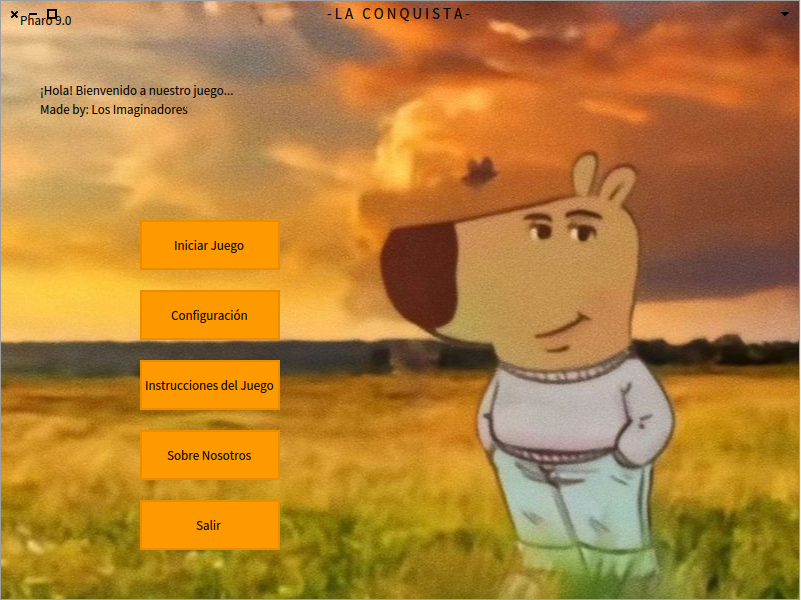
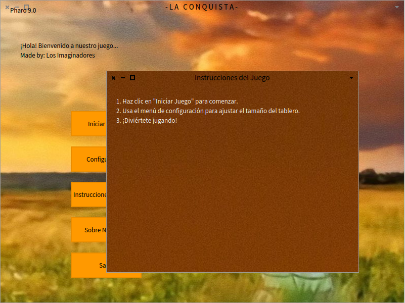
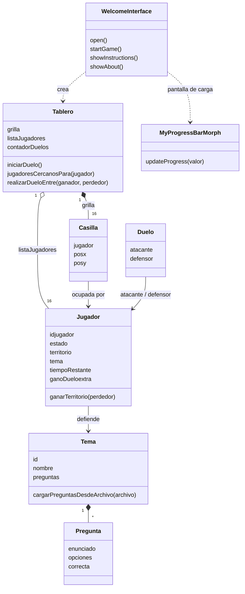

# La Conquista

A turn-based trivia game where players conquer territory by winning timed question duels. Written in **Pharo 9 (Smalltalk)** as the final project (TPI) for *Paradigmas de Programación*, UTN FRRe, 2024.

Made by **Los Imaginadores**: Juan Manuel Giraudo, María Eugenia Sánchez, Ulises Iván Ayala and Braian Leonel Wolkowyski.


> The game, the code and the docs are in Spanish. This README is in English.

**[⬇ Download for Windows](https://github.com/wolkowyski/la-conquista-pharo/releases/latest)**: unzip it and double-click `Jugar.bat`. Pharo comes bundled, so there's nothing to install.

<p align="center">
  
  
</p>

## How the game works

- The board holds **16 players**, each starting on one square with a **theme** (Matemáticas, Historia Argentina, Física, Cine Argentino…).
- Each turn a random player becomes the **challenger** and picks an opponent on an adjacent square (up, down, left or right of any square they own).
- The duel uses questions from the **defender's theme**. Players answer in turns by typing the option number.
- Each player starts every duel with a **45-second clock**. The time spent answering is subtracted, and a wrong answer costs **5 more seconds**.
- The first player to run out of time loses. The winner takes **all of the loser's squares and their theme**, and the loser is eliminated.
- The winner of every **10th duel** gets a bonus: **3 wrong answers without penalty**.
- After a duel the winner can challenge another neighbour or pass the turn to a random player.

The game runs inside the Pharo environment. A Morphic main menu (start, settings, instructions, about, exit) opens the game, and duels are played through input dialogs, with the results shown in the **Transcript**.

## Design



`Tablero` holds the game logic: it builds the grid, deals one theme per player, finds the neighbours a player can challenge and runs the duel loop. Each `Tema` loads its questions from a text file in `temas/`. The first line is the theme name, and every other line is `question;option 1;option 2;option 3;option 4;number of the correct option`.

## Running it

### Windows build

1. Download `LaConquista-Windows-x64.zip` from the [latest release](https://github.com/wolkowyski/la-conquista-pharo/releases/latest) and unzip it.
2. Double-click `Jugar.bat`. The game menu opens inside Pharo.
3. Open the Transcript (`Ctrl+O` `Ctrl+T`) to follow the duels, then click **Iniciar Juego**.

The zip contains the official Pharo 9.0.22 VM, a clean Pharo 9.0 image with the game loaded from `src/`, and the assets. If you start the VM by hand, `--interactive` must go **after** the image name (`Pharo.exe LaConquista.image --interactive`), or Pharo 9 starts without a window.

### From source

You need [Pharo Launcher](https://pharo.org/download).

1. In Pharo Launcher, create a new image from **Official distributions → Pharo 9.0 - 64bit** and launch it.
2. Open a Playground (`Ctrl+O` `Ctrl+W`) and run:

   ```smalltalk
   Metacello new
       baseline: 'LaConquista';
       repository: 'github://wolkowyski/la-conquista-pharo:main/src';
       load.
   ```

3. Copy the contents of [`assets/`](assets) (the `temas` folder and the three `.png` files) into the image folder. In Pharo Launcher, right-click the image and choose **Show in folder**.
4. Open the Transcript (`Ctrl+O` `Ctrl+T`), then start the game from the Playground:

   ```smalltalk
   WelcomeInterface open.
   ```

5. Click **Iniciar Juego** and follow the dialogs. The Transcript shows the questions, the clocks and who wins each duel.

If you'd rather not use Metacello, drag [`fileouts/A-TRABAJOPARADIGMAS.st`](fileouts/A-TRABAJOPARADIGMAS.st) onto the Pharo window and choose **File in**.

## Repository layout

| Path | Contents |
|---|---|
| [`src/`](src) | The `A-TRABAJOPARADIGMAS` package in Tonel format, plus a Metacello baseline |
| [`fileouts/`](fileouts) | The original `.st` file-outs submitted with the project. `Temas.st` is an earlier prototype of the question system |
| [`assets/temas/`](assets/temas) | Question banks: 16 themes with about 20 questions each (files 17–64 repeat them, for a planned 8×8 board) |
| [`assets/*.png`](assets) | Backgrounds for the main menu, instructions and about windows |
| [`docs/`](docs) | The project papers and team documents (Spanish) |
| [`screenshots/`](screenshots) | Screenshots for this README |

## Documentation

- [`docs/propuesta.pdf`](docs/propuesta.pdf): first delivery, with the game proposal and rules.
- [`docs/paper-final.pdf`](docs/paper-final.pdf): final paper, covering the classes, relationships and conclusions.
- [`docs/bitacora.pdf`](docs/bitacora.pdf): team log of meetings, roles and decisions.
- [`docs/matriz-de-habilidades.pdf`](docs/matriz-de-habilidades.pdf): skills matrix of the team.

## Known limitations

This is the project exactly as it was submitted in November 2024, and some parts were left unfinished:

- The original proposal describes an **8×8 board**, but the code builds a **4×4 board with 16 players**. The *Configuración* button saves a board size that the game never uses.
- The board isn't drawn. The game is played through dialogs and the Transcript.
- Cancelling an input dialog during a duel raises an error (`nil asInteger`).
- `Duelo` is part of the model but isn't used yet: `Tablero` runs the duels itself.

## Team

| Member | Role in the project |
|---|---|
| Juan Manuel Giraudo | Teamwork reflection and responsibility map |
| María Eugenia Sánchez | Version history, question-system prototype, game modelling |
| Ulises Iván Ayala | Team log (bitácora), game modelling |
| Braian Leonel Wolkowyski | Project papers and documentation |

Everyone took part in designing and programming the game. As the paper's bibliography notes, ChatGPT helped write the question banks and the Morphic interface.

Professor: Rubén Bernal. Universidad Tecnológica Nacional, Facultad Regional Resistencia.
